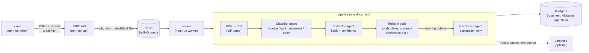

# InvoiceCheck

A portfolio project, built with Claude Code.

## What it does

InvoiceCheck takes PDF invoices, lets LLM agents (Gemini) classify the document and extract the invoice fields, and then checks those fields with deterministic rules written in code. Invoices that pass every rule get the status `ok`. Everything else gets `needs_review`, along with a short explanation for the human reviewer. Documents go in through a typed API, wait in a job queue, are processed by a worker and are stored in Postgres with a full record of what each agent received and returned.

## Architecture



The same pipeline can also be run without the queue (`npm start` processes every PDF in `samples/pdf`), and without the database (`npm run eval`).

## Key design decisions

- **Model output is a hypothesis, not a fact.** Every agent answer is parsed with a Zod schema before the code uses it. An answer that is not valid JSON or does not match the schema counts as a failure, never as data. Cached answers are validated the same way, because a cache file could have been edited by hand.
- **Rules live in code, not in the prompt.** Sums, dates and currencies are checked by plain TypeScript functions in `src/rules.ts`. These checks are: line items add up to the total (tolerance 0.01), the date is present, in `YYYY-MM-DD` format and not in the future, the currency is one of `EUR`, `USD` and `UAH`, and the total is positive. The model never decides whether an invoice is correct.
- **The reconciler can only explain.** Its output schema has a single field, `explanation`. The code takes no numbers or fields from its answer, so it cannot "fix" an invoice. It receives only the extracted data and the list of problems, not the PDF text.
- **Confidence threshold and `null` instead of guessing.** The extractor returns a confidence from 0 to 1 for every field. Any field below 0.8 sends the document to `needs_review`. A value that is not in the document must be `null`, and a missing date or currency is reported as a problem rather than filled in.
- **Idempotency in two steps: file hash, then business key.** Every file is identified by the SHA-256 of its bytes. That hash is the unique key in Postgres and also the BullMQ `jobId`. Uploading the same file twice does not create a second job or a second AI call, and re-uploading a failed file retries it. A different file with the same invoice inside is caught after extraction by the pair `invoiceNumber + vendor`. That pair has a unique index in Postgres. Such a document is reported as `duplicate` and is not saved again.
- **Transient vs permanent errors.** Rate limits (429), server errors (5xx), timeouts and network errors are marked temporary: the worker throws a normal `Error` and BullMQ retries the job (3 attempts, exponential backoff starting at 5 s). Errors that a retry cannot fix, such as invalid job data or an answer that fails the schema, raise `UnrecoverableError` and the job goes straight to `failed`. Inside one job, each agent has a 20 s budget for all of its attempts.
- **Typed tRPC contract.** The client imports only the *type* `AppRouter` from the server, so a renamed field breaks compilation instead of breaking at runtime. Inputs and outputs are Zod schemas. Uploads are checked by content (`%PDF-` magic bytes, valid base64, max 5 MB), not by file name. Every procedure except `health` requires the `x-api-key` header, and the key is compared in constant time.

## Failure modes I found and fixed

- **The reconciler invented a cause.** For an invoice whose total did not match its line items, the reconciler explained it with "poor print quality". Nothing in the data supported that. The fix: the prompt now forbids speculation about printing, scanning, typos or anything else that is not visible in the data. The eval also checks every explanation automatically: each number in it must appear in the extracted data or in the problem list.
- **`--legacy-peer-deps` silently removed dependencies while the tests stayed green.** Installing with this flag pruned the OpenTelemetry packages that `@langfuse/otel` needs as peer dependencies. The tests do not exercise tracing, so they still passed, but the worker broke. The fix: those packages (`@opentelemetry/api`, `core`, `sdk-trace-base`, `exporter-trace-otlp-http`) are now explicit dependencies in `package.json`. Before publishing, a clean `npm ci` was followed by running tsc, the tests, the worker, the API and the client.
- **The same invoice was saved twice when its PDF was regenerated.** pdfkit writes the creation date into every file, so running `npm run make-pdfs` again produced files with the same text but different bytes and a different SHA-256. The byte hash was the only duplicate check, so the same invoice passed it and was saved as a new document. The model cache hid the problem: it is keyed by `sha256(model + prompt)`, and the prompt contains the text, so no extra Gemini calls were made. The fix is a second duplicate check by the business key `invoiceNumber + vendor`. After the Extractor runs, `saveDocument` looks for an existing document with the same pair (both stored as columns with a unique index). If one exists, it saves nothing and returns `duplicate`. The worker, `npm start`, the API (`state: "duplicate"`) and the client all report it. The check is skipped when either value is `null`, so two invoices without a number are never merged. A test (`tests/duplicate.test.ts`) renders the same invoice twice with different creation dates. It checks that the bytes and hashes differ while the text is the same, and that the second copy is detected as a duplicate of the first.

## Evaluation

`npm run eval` runs every PDF in `samples/pdf` through the full pipeline (without saving to the database) and compares the result with `evals/expected.json`. The set has 8 documents: 3 plain invoices with known outcomes (correct, wrong total, missing date), 3 tricky invoices (date written in words, European number format `1.225,50`, "Total due" wording), one bank statement and one scanned PDF with no text layer.

Current results (model `gemini-3.5-flash-lite`, answers from cache):

| Metric | Result |
|---|---|
| Fields (invoice number, total, currency, date, triggered rules; 5 per document) | **100%** (40/40) |
| Status (`ok` / `needs_review`) | **100%** (8/8) |
| Explanations with invented numbers | **0 of 2** |

**Regression experiment.** To check that the eval actually catches a broken prompt, I removed one instruction from the Extractor prompt: the date format hint `// value format YYYY-MM-DD`. Then I ran `npm run eval -- --fresh` on the two files where the date is not written as `YYYY-MM-DD` in the document: `invoice-date-words.pdf` and `invoice-eu-format.pdf`.

| Extractor prompt | Fields | Status |
|---|---|---|
| Without the date format line | 60% (6/10) | 0% (0/2) |
| Prompt restored | 100% (10/10) | 100% (2/2) |

Without the hint, the model returned the dates as they appear in the documents, `"12 March 2026"` and `"30.08.2026"`, instead of `YYYY-MM-DD`. The date rule in code (`dateNotInFuture`) rejected the wrong format, so both documents got `needs_review` instead of the expected `ok`. The eval caught the regression, and the bad data did not pass as `ok`.

When Langfuse keys are set, the eval also attaches scores (`eval_fields`, `eval_status`, `eval_no_invented_numbers`) to each document's trace.

## Tech stack

- TypeScript, Node.js 22, ESM, run with `tsx`
- Gemini API (`@google/genai`), model `gemini-3.5-flash-lite`
- Zod for every boundary: model output, cache files, job data, API input and output, `expected.json`
- PostgreSQL 16 with Prisma 7 (`@prisma/adapter-pg`)
- Redis 7 with BullMQ for the job queue
- tRPC 11 (standalone HTTP server and typed client)
- Langfuse via OpenTelemetry for traces and eval scores (optional)
- pdf-parse to read PDFs, pdfkit to generate the sample PDFs
- Vitest for tests, Docker Compose for Postgres and Redis

## How to run

You need Node.js 22 (see `.nvmrc`), Docker Desktop and a Gemini API key.

```bash
# 1. Get the code and install exact dependency versions
git clone https://github.com/<your-username>/invoicecheck.git
cd invoicecheck
nvm use            # switches to Node 22 from .nvmrc (skip if you already use Node 22)
npm ci

# 2. Configure secrets: fill in GEMINI_API_KEY, DATABASE_URL, REDIS_URL and API_KEY
cp .env.example .env
#    (the comments in .env.example show where to get each value)

# 3. Start Postgres and Redis
docker compose up -d

# 4. Create the tables and generate the Prisma client
npx prisma migrate deploy --config prisma7.config.ts
npx prisma generate --config prisma7.config.ts

# 5. Check that everything compiles and the tests pass (no Gemini calls)
npx tsc --noEmit
npm test
```

First result, the simple way: process every PDF in `samples/pdf` and save it to Postgres.

```bash
npm start
```

First result through the API and the queue (three terminals):

```bash
npm run worker                                     # terminal 1
npm run api                                        # terminal 2, http://localhost:3000
npm run client -- samples/pdf/invoice-bad-total.pdf # terminal 3
```

Other commands:

| Command | What it does |
|---|---|
| `npm run eval` | Compare the pipeline with `evals/expected.json` (`-- --fresh` ignores the cache) |
| `npm run enqueue` | Put every PDF from `samples/pdf` into the queue |
| `npm run failed` | Show failed jobs (`-- --retry` sends them again) |
| `npm run make-pdfs` | Regenerate `samples/pdf` from the `.txt` samples |
| `npm run reset` | Clear the database tables, the queue and the model cache |

A fresh clone has no model cache, so the first `npm start` or `npm run eval` calls Gemini for real: up to 3 calls per document (classifier, extractor, and the reconciler only when there are problems), with a pause between calls. On the free tier the daily request limit is low, so process a few files at a time if you hit `429`. Later runs reuse the answers from `cache/`.

## Limitations and next steps

- **Synthetic test invoices.** All samples are generated from text files with pdfkit. Real invoices have tables, logos, several pages and messy layouts. Next step: a set of real, anonymized invoices.
- **Small eval set.** 8 documents are enough to catch a broken prompt, but not enough to measure accuracy with confidence. Next step: more documents per tricky case, and tracking results over time.
- **No OCR.** A scanned PDF without a text layer is detected and sent to `needs_review` with "no text layer, OCR required". It is never read. Next step: OCR, or sending the page image to a multimodal model.
- **The business key depends on the model.** Duplicates are matched on the exact `invoiceNumber` and `vendor` strings returned by the Extractor. If the model writes the vendor differently for two copies (for example `GmbH` vs `GmbH.`), they are not recognised as the same invoice. If either field is `null`, there is no duplicate check at all. Next step: normalise both values (case, spaces, punctuation) before comparing them.
- **One model provider.** Everything runs on Gemini. An outage or quota limit stops the pipeline. Next step: a provider-independent agent interface and a fallback provider.
- **LLM confidence tends to be overestimated.** The confidence is the model's own self-report. In the current eval it is 1 for almost every field, so the 0.8 threshold rarely fires. Next step: calibrate it against the eval results, or derive confidence from independent checks instead of the model's opinion.
